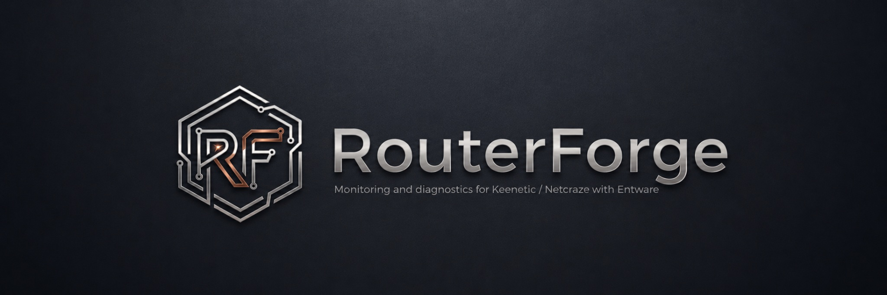

<p align="center">
  
</p>

# RouterForge

**Русский** | [English](README_EN.md)

[](https://github.com/Fifth-Ace/routerforge/actions/workflows/ci.yml)
[](https://github.com/Fifth-Ace/routerforge/releases/tag/routerforge-stable)
[](https://github.com/Fifth-Ace/routerforge/releases/tag/routerforge-beta)
[](LICENSE)

**RouterForge** — модульная веб-платформа для роутеров **Keenetic / Netcraze с Entware**. Объединяет мониторинг, управление системой, DNS, диагностику сети, сетевые инструменты и безопасность в одном интерфейсе.

RouterForge работает с KeeneticOS/NDMS и Entware через `ndmc`, RCI и системные интерфейсы. Web UI доступен на **`:2233`**, а модули подключаются к Core через Unix sockets.

> [!NOTE]
> **RouterForge — независимый некоммерческий проект сообщества.** Он не является официальным продуктом, подразделением или партнёрским проектом Keenetic, Netcraze, Entware. Все товарные знаки принадлежат их владельцам. Лицензия проекта — MIT.

> [!TIP]
> Core и модули версионируются независимо — [Versioning Policy](docs/VERSIONING.md).

## Установка

Для установки необходимы Keenetic / Netcraze с Entware, доступ к терминалу и подключение к интернету.

### Stable

Стабильный канал для повседневного использования.

```sh
/opt/bin/opkg update && /opt/bin/opkg install curl && /opt/bin/curl -fsSL https://github.com/Fifth-Ace/routerforge/releases/download/routerforge-stable/routerforge-stable-bootstrap.sh | sh
```

### Beta

Канал предварительных выпусков с новыми модулями и возможностями.

```sh
/opt/bin/opkg update && /opt/bin/opkg install curl && /opt/bin/curl -fsSL https://github.com/Fifth-Ace/routerforge/releases/download/routerforge-beta/routerforge-beta-bootstrap.sh | sh
```

После установки откройте `http://<ip-роутера>:2233`.

**Stable и Beta — отдельные каналы обновлений.** Переключайте их осознанно. Подробнее: [Установка и обновление](docs/INSTALLATION.md).

## Архитектура

RouterForge состоит из Core и независимых модулей, которые устанавливаются по необходимости.

```text
Browser
   |
   | http://router:2233
   v
RouterForge Core
├── Web UI / REST / SSE
├── Authentication / Settings
├── App Center / Registry / Releases
├── Module ABI host
└── Unix-socket proxy
     ├── DNS
     ├── Management
     │    ├── Processes / Services
     │    ├── File Manager / Maintenance
     │    ├── Entware Terminal
     │    └── Keenetic NDM Console
     ├── Monitoring
     │    ├── System / Thermal
     │    ├── Storage
     │    └── Network
     ├── Network Tools
     │    ├── Network Doctor
     │    ├── Route Inspector
     │    ├── Flow Explorer
     │    └── Active Probes
     ├── NFQWS Manager
     │    ├── Diagnostics / AutoSelect
     │    ├── Strategies / Config / Lists
     │    ├── Smart Apply / Backups
     │    ├── DPI Detector
     │    └── NFQWS Menu
     ├── Antiscan Manager
     │    ├── Status / Diagnostics
     │    ├── Config / Custom Lists / ipset
     │    └── Operations / Recovery
     ├── Port Access Manager
     │    ├── knockd
     │    ├── fwknopd / SPA
     │    └── iptables recent / odin
     └── CrowdSec Manager
          ├── Firewall Bouncer
          ├── LAPI / ipset / iptables
          └── Protection / Diagnostics
```

`routerforge-profiling` работает отдельно и по умолчанию доступен только на `127.0.0.1:6061`.

Backend написан на Go. Для модулей не требуются отдельные общедоступные HTTP-серверы. Подробнее: [Архитектура RouterForge](docs/ARCHITECTURE.md).

## Почему RouterForge

- **Создан специально для Keenetic / Netcraze.** Архитектура, runtime и интерфейс ориентированы на KeeneticOS/NDMS и Entware.
- **Глубокая интеграция.** Работа с `ndmc`, RCI, маршрутами, интерфейсами, DNS, policy routing и службами.
- **Один интерфейс.** Управление системой, Центр приложений, диагностика и обслуживание через Web UI.
- **Модульная установка.** Core — основа, остальные компоненты подключаются по необходимости.
- **Экономный runtime.** Go backend, без Node.js на роутере и без лишних внешних HTTP-сервисов.
- **Контролируемые изменения.** Проверки, подтверждения, резервные копии и откат там, где он предусмотрен.
- **Проверяемые релизы.** Сборки под разные архитектуры, SHA256, индексы пакетов и неизменяемые снимки выпусков.

## Модули RouterForge

Возможности доступны в зависимости от установленного канала и состава выпуска. Устанавливайте только нужные модули.

### Core — единая точка управления
`routerforge-core`

Web UI, авторизация, настройки, Центр приложений, управление модулями, обновлениями и базовая телеметрия. **Нужен всем:** Core — основа платформы.

### DNS — управление DNS и резолверами
`routerforge-dns`

DNS, DoT и DoH, состояние резолверов, задержки, ошибки и fallback, временное отключение серверов без удаления настроек. **Нужен, если:** хотите контролировать качество работы DNS.

### Management — администрирование из браузера
`routerforge-admin`

Процессы и службы Entware, файловый менеджер, обслуживание, Entware Terminal и Keenetic NDM Console. **Нужен, если:** хотите выполнять повседневные задачи без постоянного SSH.

### Monitoring — мониторинг роутера
`routerforge-monitoring`

CPU, память, температура, накопители, сетевые интерфейсы и состояние устройства. **Нужен, если:** хотите быстро видеть состояние ресурсов роутера.

### Network Tools — сетевая диагностика
`routerforge-network-tools`

Network Doctor, Route Inspector, Flow Explorer и Active Probes: маршруты, соединения, доступность и сетевой путь. **Нужен, если:** используете несколько WAN, VPN или сложную маршрутизацию.

### NFQWS Manager — управление nfqws2
`routerforge-nfqws-manager`

Конфигурация и профили существующего `nfqws2-keenetic`, списки, диагностика сайтов, автоподбор стратегий, тестирование, контролируемое применение настроек и резервные копии. **Нужен, если:** хотите управлять nfqws2 и диагностировать проблемы из одного интерфейса.

### Antiscan Manager — управление Antiscan
`routerforge-antiscan-manager`

Настройка установленного Antiscan, диагностика, списки, ipset, служба, планировщик и восстановление. **Нужен, если:** используете Antiscan и хотите управлять им через RouterForge.

### Port Access Manager — контроль доступа к портам
`routerforge-port-access-manager` · **Beta**

Управление доступом к сервисам и проброшенным портам через knockd, fwknopd / SPA и iptables recent / odin. Настройки, состояние служб и защитные проверки. **Нужен, если:** хотите использовать Port Knocking или SPA для сетевых сервисов.

### CrowdSec Manager — управление Firewall Bouncer
`routerforge-crowdsec-manager` · **Beta**

Подключение к CrowdSec LAPI, управление Firewall Bouncer, диагностика ipset/iptables и статистика блокировок. **Нужен, если:** используете CrowdSec для защиты сети.

### Profiling — диагностика RouterForge
`routerforge-profiling`

Локальное профилирование Core для анализа производительности. **Большинству пользователей не нужен.**

## Поддерживаемая платформа

RouterForge разрабатывается для Keenetic / Netcraze с Entware.

| Архитектура | Статус |
| --- | --- |
| `aarch64-3.10` | Основная, физически проверенная |
| `mipsel-3.4` | Experimental, частично проверенная |
| `mips-3.4` | Experimental |

Нужны Entware в `/opt`, `opkg`, root-доступ и `curl` или `wget`. Подробная матрица: [docs/ARCHITECTURES.md](docs/ARCHITECTURES.md).

## Сообщество

Вопросы, предложения и обсуждение RouterForge — в **[Telegram @RouterForge](https://t.me/RouterForge)**. Ошибки и технические задачи можно оформлять через [GitHub Issues](https://github.com/Fifth-Ace/routerforge/issues).

## Документация

- [Документация RouterForge](docs/README.md)
- [Последний Stable](https://github.com/Fifth-Ace/routerforge/releases/tag/routerforge-stable)
- [Последняя Beta](https://github.com/Fifth-Ace/routerforge/releases/tag/routerforge-beta)
- [Все выпуски и история изменений](https://github.com/Fifth-Ace/routerforge/releases)
- [Установка и обновление](docs/INSTALLATION.md)
- [Архитектура](docs/ARCHITECTURE.md)
- [Модули](docs/MODULES.md)
- [Центр приложений](docs/MARKETPLACE.md)
- [Management v2](docs/MANAGEMENT_V2_API.md)
- [Политика версионирования](docs/VERSIONING.md)
- [Диагностика](docs/TROUBLESHOOTING.md)
- [Changelog](CHANGELOG.md)

## Для разработчиков

Backend: **Go 1.21+**. Frontend: **Node.js 22.x**.

```sh
sh scripts/build-frontend.sh
sh scripts/build-dns-frontend.sh
sh scripts/build-admin-frontend.sh
sh scripts/build-monitoring-frontend.sh
go test ./...
go vet ./...
```

Подробнее: [CONTRIBUTING.md](CONTRIBUTING.md).

## Лицензия

[MIT](LICENSE) · Copyright © 2026 Fifth-Ace.
